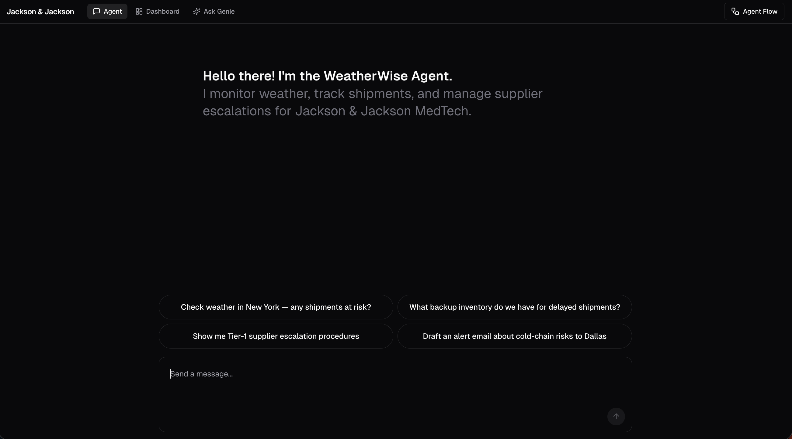
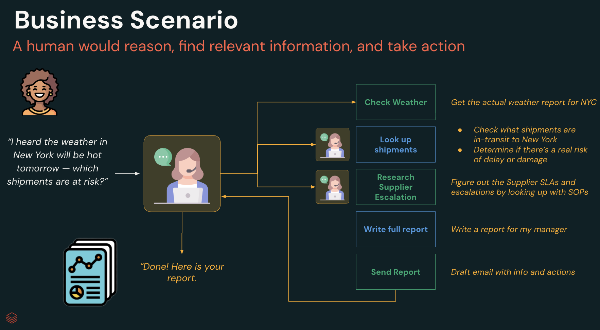
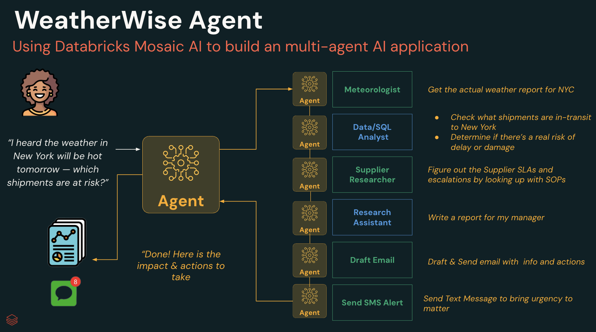
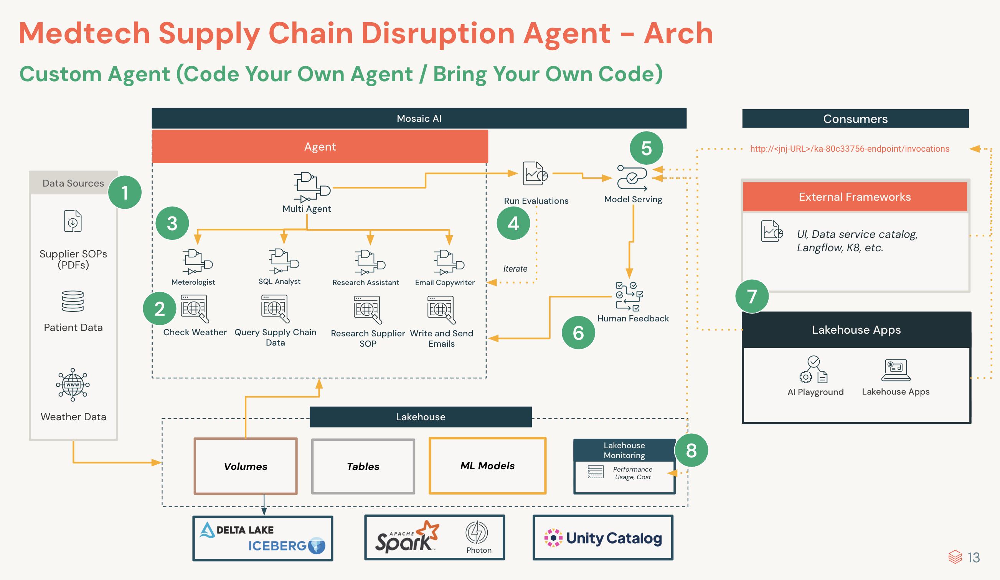
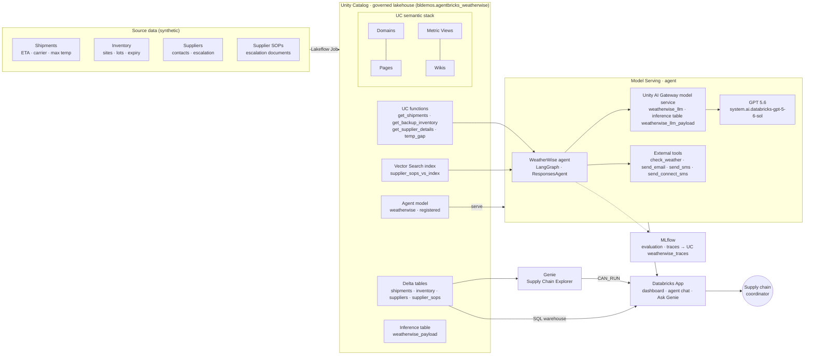

## MedTech Weatherwise Agent - Intelligent Supply Chain

The **WeatherWise Supply Chain Escalation Agent** helps MedTech operations teams **anticipate and mitigate weather-related shipment risks** using live data, predictive reasoning, and automated escalation workflows.



---

### Mission
Detect and resolve **shipment disruptions** before they impact **patients, compliance, or cost**.

---

### Scenario

Business Process


Agent Flow


---

### Architecture



### Data Flow

Left to right, the same flow the app's **Data Flow** modal animates:



| Stage | What happens | Where |
|---|---|---|
| **Ingest** | CSVs land as Delta tables; UC functions and the SOP vector index are created | `data/setup_data.ipynb`, `agent_src/tools/uc_tools/` |
| **Build + evaluate** | Agent is unit-tested, evaluated with LLM judges, logged and registered to UC; traces are archived to UC table `weatherwise_traces` | `agent_src/agent_eval_notebook.ipynb` (Lakeflow Job `weatherwise-agent-eval`) |
| **Serve** | `agents.deploy` puts the registered version on Model Serving; the agent calls GPT through the **Unity AI Gateway** | endpoint `agents_bldemos-agentbricks_weatherwise-weatherwise` |
| **Experience** | The app reads KPIs from the SQL warehouse, chats with the agent endpoint, and asks Genie | `dapp/` (app `weatherwise-chat-agent`) |

> A person approves every escalation. All demo data is synthetic.

---

### Example Queries

| Category | Example |
|-----------|----------|
| **Full Automation** | "The weather in New York will be hot tomorrow. Which in-transit shipments are at risk, what escalation steps should I take, and is there a backup supplier nearby? Email me a report and send an SMS summary." |
| **Weather Risks** | "Which shipments are at risk due to high temperatures in NYC?" |
| **Delivery Status** | "Show in-transit implant shipments for this week." |
| **Supplier SOPs** | "What's Zimmer's escalation process for temperature exceptions?" |

---

### Business Value

#### Speed
- **Hours to seconds** for risk detection
- Automated **weather + shipment correlation**
- One-click **escalation and notification**

#### Savings
- Avoids **spoilage, delays, and SLA fines**
- Reduces **manual triage workload**
- Maximizes **on-time, in-spec delivery**

#### Compliance
- Follows **supplier SOPs automatically**
- Provides **audit-ready traceability**
- Strengthens **patient safety assurance**

---

### Escalation Crew — Agents and Tools

#### METEOROLOGIST
**Role:** Weather and risk analyst
**Goal:** Analyze forecast data and compute temperature gaps between ambient and shipment thresholds
**Tools:** `check_weather`, `temp_gap`

---

#### SQL ANALYST
**Role:** Data analyst focused on MedTech shipment logistics
**Goal:** Retrieve shipments (optionally filtered by destination and/or status) and expose the maximum allowable temperatures needed for risk evaluation
**Tools:** `get_shipments`, `get_backup_inventory`

---

#### SUPPLIER RESEARCHER
**Role:** Knowledge analyst specializing in supplier compliance and escalation workflows
**Goal:** Identify supplier-specific SOPs, escalation contacts, and nearby backup inventory
**Tools:** `get_supplier_details`, `search_supplier_sops`

---

#### EMAIL COPYWRITER
**Role:** Communications agent for detailed escalation summaries
**Goal:** Compose and send email reports summarizing affected shipments and next steps
**Tools:** `send_email` (via any email service API)

---

#### TEXTER
**Role:** Rapid notifier for short alerts
**Goal:** Send SMS notifications to field or operations teams for immediate awareness
**Tools:** `send_sms` (via any SMS service)

---

### Tools Overview

#### Unity Catalog Tools
| Tool | Description |
|------|--------------|
| `get_shipments` | Retrieve shipment, carrier, and temperature data |
| `get_backup_inventory` | Identify alternate or nearby stock locations |
| `get_supplier_details` | Retrieve supplier info and escalation contacts |
| `temp_gap` | Calculate ambient vs. threshold temperature differences |
| `search_supplier_sops` | Retrieve escalation SOPs from the vector search index |

#### Custom Tools
| Tool | Description |
|------|--------------|
| `check_weather` | Get live or forecasted weather for destination routes |
| `send_email` | Send escalation summaries via **Mailgun** (or any email service API) |
| `send_sms` | Send short alerts via **Twilio SMS** |
| `send_connect_sms` | Event networking: one greeting text with a LinkedIn link (`LINKEDIN_URL`) |

---

### Demo Data Sources

| File | Description |
|------|--------------|
| `shipments.csv` | Shipment details, ETA, carrier, and temperature logs. Each row carries its product's own allowed range (`temperature_min_f` / `temperature_max_f`) |
| `suppliers.csv` | Supplier contacts and escalation references |
| `inventory.csv` | Warehouse and backup inventory data |
| `supplier_sops.csv` | Product-specific supplier SOPs and escalation documents (for RAG), one per product |

Synthetic product lines (fictional, based on real device and biologic categories):

| Product | Based on | Allowed range (°F) | Why |
|---------|----------|--------------------|-----|
| Frozen Fibrin Sealant Kit | Frozen topical fibrin sealant | -22 to -4 | Must stay frozen; a dry-ice gap thaws it |
| Frozen Bone Allograft (cryopreserved) | Cryopreserved bone tissue | -112 to -40 | Deep-frozen; warming means quarantine |
| Refrigerated Thrombin Hemostat | Refrigerated topical thrombin | 36 to 46 | 2–8 °C; freezing or warming is an excursion |
| Corneal Tissue Graft (cold-storage medium) | Eye-bank corneal graft | 36 to 46 | 2–8 °C; freezing destroys the tissue |
| Bioprosthetic Aortic Valve (bovine tissue) | Bioprosthetic tissue valve | 50 to 77 | Room temperature; never freeze |
| Cardiac Stent Kit (coated) | Drug-eluting coronary stent | 59 to 77 | Heat degrades the drug coating |
| Drug-Coated Balloon Catheter (paclitaxel) | Paclitaxel drug-coated balloon | 59 to 86 | Upper-limit product; heat is the failure mode |

---

## Installation & Setup

### Prerequisites

* **Databricks workspace** with **Unity Catalog** enabled
* **MLflow 3.0+** with **Model Serving**

#### Optional Custom Tools

* **Mailgun** — for email alerts. Obtain API credentials from your Mailgun account.
* **Twilio** — for SMS alerts. Obtain API credentials from your Twilio account.

> **Note:**
> If you don't plan to use Email or SMS, remove those tools from `weatherwise_agent.py` and update the system prompt accordingly.
> If you do plan to use them, configure the services first, then use `tests/manually_test_tools.ipynb` to verify the integrations before running the agent.

---

### Repository Design

```
databricks.yml                    # Bundle: the Databricks App + the agent eval Lakeflow Job
.env                              # Your config + secrets (gitignored; synced to your workspace folder)
_env                              # Template for .env (no secrets)
setup.sh                          # One-shot setup script (imports notebooks, runs them as jobs)

agent_src/
├── weatherwise_agent.py          # LangGraph ResponsesAgent; LLM via Unity AI Gateway (ChatOpenAI)
├── agent_eval_notebook.ipynb     # Unit test → log → evaluate → register (UC) → deploy (Model Serving)
└── tools/
    ├── uc_tools/                 # UC SQL functions + supplier SOP vector index notebooks
    └── custom_tools/             # check_weather (Open-Meteo), send_email (Mailgun), send_sms + send_connect_sms (Twilio)

dapp/                             # Databricks App: FastAPI backend + React frontend
├── app.py                        # /api/health · /api/overview · /api/shipments/at-risk
│                                 # /api/genie/ask · /api/agent/chat; serves the built SPA
├── app.yaml                      # Runtime env; valueFrom keys match bundle resource names
├── requirements.txt
├── frontend/                     # Vite + React 19 + lucide (no Tailwind) → builds into dapp/static
│   └── src/components/           # CommandCenter · NetworkMap · AssistantDrawer (AgentChat + GeniePanel) · Modals · Markdown
└── static/                       # Built SPA (committed so the app deploys without a Node build)

data/                             # setup_data.ipynb + demo CSVs
genie/                            # Scripts to create the SQL warehouse and Genie space
tests/manually_test_tools.ipynb   # Manual tool checks (weather, email, SMS)
img/                              # README / solution-brief screenshots
```

**App layout.** One **Command Center** page:
- KPI strip (shipments, in transit, delayed, temperature excursions, surgeries at risk, on-hand units)
- US **network map** (supply centers, distribution centers, hospitals, clinics, routes colored by risk) with a "Surgeries at risk" list
- **Active shipments** table with **status chips** (All · In-Transit · Delayed · …) that filter the table *and* the map's routes; clicking a row highlights the route; **Ask** sends that shipment to the agent
- On-hand units by site

A push-style **assistant drawer** (header button or floating "Ask WeatherWise") holds two tabs: the **WeatherWise Agent** (acts: tools, SOPs, alerts; shows a grouped, expandable tool-call trace) and **Ask Genie** (answers data questions with SQL). Header buttons open **Problem & Solution**, **Outcome Maps** (Life Sciences), and the animated **Data Flow**.

Priority **STAT** = needed for a scheduled procedure (ship immediately); **Surgery at risk** = ETA after the procedure date; **excursion** = latest sensor reading above the SOP max.

**Bundle resources** (`databricks.yml`, target `dev` by default):

| Resource | Name | Purpose |
|---|---|---|
| App | `weatherwise-chat-agent` | Source `./dapp`; bound to the agent endpoint (`CAN_QUERY`), SQL warehouse (`CAN_USE`), Genie space (`CAN_RUN`) |
| Job | `weatherwise-agent-eval` | Runs `agent_src/agent_eval_notebook.ipynb` on serverless |

Sync rules: `.env` is explicitly **included** (it is gitignored, but the notebook reads it in the workspace); `dapp/frontend/node_modules` is **excluded** (otherwise app deploys hang on "Downloading source code").

---

### 1. Configure Environment

Copy `_env` to `.env` and fill it in. `.env` is gitignored but uploaded to your private workspace folder by the bundle.

| Variable | Used by | Notes |
|---|---|---|
| `TARGET_CATALOG`, `TARGET_SCHEMA` | agent, notebooks | e.g. `bldemos` / `agentbricks_weatherwise` |
| `AGENT_NAME` | notebook, email tool | UC model name `<catalog>.<schema>.<AGENT_NAME>`; email sender name |
| `MLFLOW_EXPERIMENT` | notebook | Experiment under `/Users/<you>/` |
| `VS_INDEX`, `VS_INDEX_BASE_TABLE`, `RETRIEVER_TOOL_NAME` | agent, vector index notebook | SOP retrieval |
| `AI_GATEWAY_MODEL` | agent, `setup_ai_gateway` | Unity AI Gateway **model service** the agent calls, e.g. `bldemos.agentbricks_weatherwise.weatherwise_llm` (required) |
| `LLM_DESTINATION_MODEL` | `setup_ai_gateway`, agent | Model the service routes to, e.g. `system.ai.databricks-gpt-5-6-sol` |
| `AGENT_LLM_SECRET_SCOPE` | notebook | Secret scope holding the agent LLM service principal's OAuth credentials (default `weatherwise-agent`) |
| `AI_GATEWAY_BASE_URL` | agent | `https://<workspace>/ai-gateway/mlflow/v1` |
| `DATABRICKS_HOST`, `DATABRICKS_TOKEN` | local runs only | **Not needed** in the workspace (job identity) and **not** passed to the endpoint |
| `MAILGUN_API_URL`, `MAILGUN_API_KEY`, `SENDER`, `RECIPIENT` | `send_email` | Optional |
| `SMS_ACCOUNT_SID`, `SMS_AUTH_TOKEN`, `SMS_ACCOUNT_ID` | `send_sms` | Optional. Either an API key (`SK…` + key secret + `SMS_ACCOUNT_ID="AC…"`) or the account SID (`AC…`) + Auth Token |
| `WAREHOUSE_ID`, `GENIE_ID` | reference | The app gets these from bundle resources (`databricks.yml`), not `.env` |

---

### 2. Load Data & Initialize Assets

Run **`data/setup_data.ipynb`** to load the CSVs into **Delta tables**, then:

* **`agent_src/tools/uc_tools/tool_uc_functions.ipynb`** — create the Unity Catalog function tools
* **`agent_src/tools/uc_tools/tool_uc_vector_index.ipynb`** — build the supplier SOP **Vector Search index**

> **Tip:** Review the system prompt in `agent_src/weatherwise_agent.py` to understand the agent's persona, tools, and workflow.

---

### 3. Deploy the Bundle

```bash
databricks bundle validate --profile <PROFILE>
databricks bundle deploy   --profile <PROFILE>
```

This uploads the repo (including `.env`) to `/Workspace/Users/<you>/weatherwise-agent-demo/files`, creates the agent eval job, and configures the app.

---

### 4. Build, Evaluate, Register, and Deploy the Agent

```bash
databricks bundle run agent_eval --profile <PROFILE>
```

The job runs `agent_src/agent_eval_notebook.ipynb` end to end:

| Step | Description |
|------|--------------|
| **a. Setup MLflow** | Set the experiment |
| **b. Import agent** | Load `weatherwise_agent.py` and its tools |
| **c. Unit test** | One full escalation request, traced |
| **d. Log** | `mlflow.pyfunc.log_model` with UC function + vector index resources |
| **e. Evaluate** | `mlflow.genai.evaluate` with Correctness, Safety, RelevanceToQuery, Guidelines |
| **f. Register** | New version of `<catalog>.<schema>.<AGENT_NAME>` in Unity Catalog |
| **g. Deploy** | `agents.deploy` → endpoint `agents_<catalog>-<schema>-<AGENT_NAME>` (15–25 min to become READY) |

You can also open the notebook in the workspace and run it interactively.

---

#### LLM via a Unity AI Gateway model service

`agent_src/setup_ai_gateway.py` (first task of the `agent_eval` job) creates the model service `<catalog>.<schema>.weatherwise_llm`, which routes to `LLM_DESTINATION_MODEL` and logs every LLM call to the inference table `weatherwise_llm_payload`. The deployed agent calls it as a dedicated service principal, because Model Serving's automatic auth passthrough doesn't cover model services:

```bash
./scripts/setup_agent_llm_sp.sh DEFAULT   # once (workspace admin): SP + secret scope weatherwise-agent; --rotate to mint a new secret
```

The notebook passes `LLM_HOST` and `LLM_CLIENT_ID`/`LLM_CLIENT_SECRET` as `{{secrets/weatherwise-agent/...}}` references; `setup_ai_gateway` grants the SP `EXECUTE` on the service. The agent's tools keep automatic auth passthrough via the declared resources, so **no PAT is stored on the endpoint**. LLM calls attach a fresh OAuth token per request.

#### MLflow traces in Unity Catalog

The notebook uses the experiment named by `MLFLOW_EXPERIMENT` (under `/Users/<you>/`). Notebook runs **and** the served endpoint (via `MLFLOW_EXPERIMENT_ID`) log traces there, and `mlflow.tracing.archival.enable_databricks_trace_archival(...)` copies them into **one** Delta table:

| Table | Contents |
|---|---|
| `<catalog>.<schema>.weatherwise_traces` | Agent traces from the experiment (archived periodically, so new traces appear after a short delay) |
| `<catalog>.<schema>.weatherwise_payload` | Serving endpoint inference table: raw request/response payloads (endpoint AI Gateway config, not traces) |

Override the table with `TRACE_TABLE` (full name) in `.env`.

---

### 5. Deploy the App

```bash
cd dapp/frontend && npm install && npm run build && cd -   # only after UI changes
databricks bundle deploy --profile <PROFILE>
databricks bundle run weatherwise_chatapp --profile <PROFILE>
```

Local development: run `uvicorn app:app --port 8000` in `dapp/` (with `WAREHOUSE_ID`, `GENIE_SPACE_ID`, `SERVING_ENDPOINT` set) and `npm run dev` in `dapp/frontend/` (Vite proxies `/api` to port 8000).

---

© 2025 — *Authored by Bobby Leach*

## AI/BI dashboard

`dashboards/weatherwise_insights.lvdash.json` is the **WeatherWise Supply Chain Insights** dashboard (KPIs, arrivals by status, delay causes, excursions by product, delays by carrier, destination map, backup-stock heatmap, at-risk table; global filters for priority, carrier, product and state; linked to the Genie space). The app's **Dashboard** button opens the published version (`DASHBOARD_ID` in `dapp/app.yaml`).

```bash
databricks lakeview update <DASHBOARD_ID> --dataset-catalog bldemos --dataset-schema agentbricks_weatherwise \
  --serialized-dashboard "$(cat dashboards/weatherwise_insights.lvdash.json)" --profile DEFAULT
databricks lakeview publish <DASHBOARD_ID> --warehouse-id <WAREHOUSE_ID> --profile DEFAULT
```
